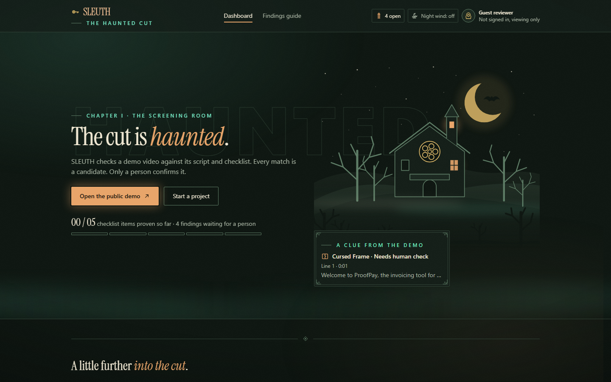
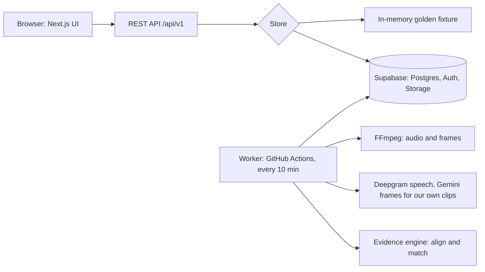

# SLEUTH

A QA workspace for software demo videos. Give it a script (what you mean to say), a video (what happened) and a checklist (what the demo must show). SLEUTH builds an evidence graph and flags problems as haunted-studio findings. Every match is a candidate. Only a person confirms it.

Built for Kiroween 2026 (Costume Contest). MIT licensed.

| Finding | Plain English |
|---|---|
| Ghost | No visual evidence |
| Phantom Dialogue | Script line not spoken |
| Cursed Frame | Needs human check |
| Poltergeist | Evidence out of date |
| Needs Outside Proof | Footage cannot prove this |

**Live:** https://sleuth-eight.vercel.app (signed out, you see the read-only demo; "Make an editable copy" starts a guest session).



## The screens

The look is a haunted house at night. Every themed label keeps its plain name beside it.

| Screen | What it shows | Screenshot |
|---|---|---|
| Dashboard hero | "The cut is haunted.", the demo's real coverage, and a clue card with one real open finding that opens its line | [desktop](docs/submission/screenshots/production/dashboard-hero-desktop.png), [mobile](docs/submission/screenshots/production/dashboard-hero-mobile.png) |
| Findings cabinet | One card per finding type, with what it means, how it is found, how to clear it, and whether it blocks the seal | [desktop](docs/submission/screenshots/production/findings-cabinet-desktop.png), [mobile](docs/submission/screenshots/production/findings-cabinet-mobile.png) |
| Claims map | The workspace floor plan: one room per script line and checklist item, in four states (covered, candidate waiting, no proof yet, stale after edit), each with its own border and icon | [desktop](docs/submission/screenshots/production/workspace-claims-map-desktop.png), [mobile](docs/submission/screenshots/production/workspace-claims-map-mobile.png) |
| The Lantern | The side panel for the chosen line: what was found, what was not, the limits, and the review actions | [desktop](docs/submission/screenshots/production/workspace-lantern-line-3-desktop.png), [mobile](docs/submission/screenshots/production/workspace-lantern-line-3-mobile.png) |
| "The final seal" | The report: blockers as locked doors, the coverage ledger, and the seal once a person signs off | [draft](docs/submission/screenshots/production/report-draft-desktop.png), [sealed](docs/submission/screenshots/production/report-sealed-desktop.png) (a rehearsal project, see below) |

These screenshots are from the live site on 14 November (`scripts/prod-screenshots.ts`, signed out, showing the public demo with its seeded results). The sealed report is a rehearsal project made with `scripts/seal-rehearsal.ts`: its candidates were confirmed by that script through the team account, not by a person watching the clip, and the note on the seal says so.

**Night wind** is optional ambient sound, made in the browser with the Web Audio API. There are no audio files. It is off until you press "Night wind" in the header. It goes quiet while the demo video plays, and it pauses when the tab is hidden.

## Try it in 2 minutes

1. Open the live site. The public demo project opens with no login.
2. On the dashboard, click the clue card, or open the demo. Pick a room in the claims map or a line of the script: the clock moves to its evidence and the Lantern opens beside it. Click a marker on the timeline and the sentence lights up.
3. Press "Make an editable copy". In the Script tab, change one sentence and save. Only that sentence's evidence goes stale (Poltergeist, evidence out of date).
4. Open "Open the Final Seal report" to see "The final seal" and what still blocks it.

## Accuracy

<!-- PLACEHOLDER (issue #67): paste the table that `pnpm eval --providers real` printed, with the date and the clip count. Do not type numbers by hand. -->

**Not measured yet.** Bảo runs the first evaluation on our five labelled clips (issue #67). The table goes here exactly as `pnpm eval` prints it.

Uploading your own video gives a speech-only check. The worker runs on a free GitHub Actions schedule, so a job can wait 10 to 15 minutes (ADR 0009).

## How it fits together



## How we used Kiro

Five specs, nine steering files, three hooks and five custom agents drove the build, and property tests written from the specs found three bugs in our own code. MCP servers are configured but disabled, and we did not use Powers. Details with links: [docs/submission/kiro-usage.md](docs/submission/kiro-usage.md). The dated log is [docs/kiro-engineering-journal.md](docs/kiro-engineering-journal.md).

## Licence

MIT, see [LICENSE](LICENSE).

## Five-minute setup (Windows, PowerShell)

You need Node 22 and Git. Run everything in PowerShell on a normal Windows folder, not inside WSL. On macOS the same commands work in a normal terminal (use `;` or newlines, not `&&` chains, if you copy the PowerShell ones).

```powershell
git clone https://github.com/dngvmnh/sleuth
cd sleuth
npm install -g pnpm@10.12.1   # or: corepack enable
pnpm install
pnpm dev
```

Open http://localhost:3000. No database, keys or Docker are needed: the app reads the golden fixture in memory (`SLEUTH_DATA_MODE=fixture`, the default).

In a second terminal, run the worker:

```powershell
pnpm worker          # long-running; Ctrl+C to stop
pnpm worker -- --once   # process the fixture job and exit
```

The worker claims the fixture job, runs the real pipeline with mock providers, and writes `.sleuth-out/analysis-output.json`. Delete `.sleuth-out/` to run the job again.

If `corepack enable` fails with `EPERM` (common with nvm for Windows), use `npm install -g pnpm@10.12.1` instead.

## Commands

| Command | What it does |
|---|---|
| `pnpm dev` | Web app on port 3000 |
| `pnpm worker` | Job worker |
| `pnpm lint` | ESLint, including package dependency direction |
| `pnpm typecheck` | TypeScript strict, every package |
| `pnpm test` | Unit tests (Vitest) |
| `pnpm test:property` | Property tests (fast-check) |
| `pnpm test:e2e` | Playwright smoke tests (run `pnpm exec playwright install chromium` once) |
| `pnpm check:contracts` | Golden fixture contract test, and `docs/api/openapi.yaml` matches the Zod schemas |
| `pnpm build` | Build web, typecheck worker |

## Layout

```
apps/web                 Next.js UI and REST routes (app/api/v1)
apps/worker              Job worker (Postgres queue, FFmpeg in Docker)
packages/contracts       Zod schemas and types: the shared shapes
packages/domain          Pure functions: segmenting, hashing, diff, invalidation, review rules
packages/db              Drizzle schema, migrations, seed, fixture store
packages/media           TranscriptionProvider and VideoAnalysisProvider plus mocks
packages/evidence-engine Matching, confidence, explanations
fixtures/golden          The shared contract fixture
docs/decisions           ADRs
.kiro                    Steering, hooks, specs
```

See `.kiro/steering/architecture.md` for the dependency rules.

## Data modes

- `fixture` (default): in-memory golden fixture. Works offline.
- `supabase`: real Postgres, Auth and Storage. Not wired into the web app yet (see `.kiro/specs/ingestion`). Copy `.env.example` to `.env.local` and fill in your own values. Never commit `.env*` files.

Fixture mode acts as a signed-in user called `fixture-user`. Send the header `x-fixture-user: anonymous` to see the signed-out view, or any other name to act as another user. The public demo project is read-only. To get something you can edit, create a project with `copyFromDemo: true`.

## The golden fixture

`fixtures/golden/proofpay-demo/` is the contract between frontend, backend and worker. `fixtures/golden/build.ts` defines it; `pnpm tsx fixtures/golden/generate.ts` writes the JSON. The contract test fails if the web data source, the database seed mapping or the worker pipeline disagree with it. The fixture has no real footage: ProofPay is an invented product and `storagePath` is a placeholder.

## API

Under `/api/v1`. Documented in `docs/api/openapi.yaml`, generated from the Zod schemas (`pnpm tsx scripts/generate-openapi.ts`). Errors always look like `{ "error": { "code", "message", "details?" } }`.

## Database

Migrations come from Drizzle only: edit `packages/db/src/schema.ts`, then `pnpm db:generate`. Row Level Security is on for every table. `pnpm db:seed` loads the demo project (needs `DATABASE_URL`).

## Kiro setup

Everything Kiro reads lives in `.kiro/` and is committed.

| Path | What it is |
|---|---|
| `.kiro/steering/` | Rules loaded into chat. Most are always on; `frontend.md`, `backend.md`, `media.md` load by file path; `ghost-hunt.md` is manual (type `/ghost-hunt` in chat). |
| `.kiro/hooks/` | Automations (Kiro 1.x `v1` JSON). They call `tools/kiro-hooks/hook.mjs`. |
| `.kiro/agents/` | Custom agents: `frontend-builder`, `backend-builder`, `media-builder`, and a read-only `qa-reviewer`. Pick one in the chat agent selector. |
| `.kiro/specs/` | Feature specs with requirements, design and tasks. |
| `.kiro/settings/mcp.json` | Suggested MCP servers, all disabled. |

Hooks:

- Domain or evidence-engine file saved by the agent: that package's unit and property tests run.
- Contracts file saved by the agent: `pnpm check:contracts`, workspace typecheck, and a reminder to label the PR `contract-change`.
- Spec task finished: typecheck and tests of the packages that changed, then an agent writes a journal entry in `docs/kiro-engineering-journal.md`.
- Ghost hunt (manual): `/ghost-hunt` reviews your diff against `ai-safety.md`.

File-save hooks fire for changes made by the Kiro agent, not for typing in the editor. CI runs the same checks on every pull request, so nothing depends on a hook. To run a hook's check yourself: `node tools/kiro-hooks/hook.mjs test domain` (also `test evidence-engine`, `contracts`, `task-check`, `ghost-scan`).

### Turning on MCP servers (optional, your own credentials)

Do not edit the committed file to enable a server. Copy the entry you want into your user-level `%USERPROFILE%\.kiro\settings\mcp.json`, set `"disabled": false`, and restart the server from Kiro's MCP panel.

- **Supabase** (read-only schema inspection): create a personal access token in your Supabase account and put your project ref in `--project-ref=`. Set the token as a user environment variable named `SUPABASE_ACCESS_TOKEN` through Windows Settings, "Edit environment variables for your account". Do not paste it into any file in this repo.
- **Playwright** (check the UI in a browser): no credentials. Needs Chromium: `pnpm exec playwright install chromium`.
- **GitHub** (review pull requests): create a fine-grained token with read access to this repo and set it as the user environment variable `GITHUB_PERSONAL_ACCESS_TOKEN`. Kiro versions differ in how they expand `${VAR}` in `headers`; if the server will not connect, use the `gh` CLI instead.

Never share tokens in chat, issues or commits. If one leaks, rotate it.

## Contributing

See `CONTRIBUTING.md`.
