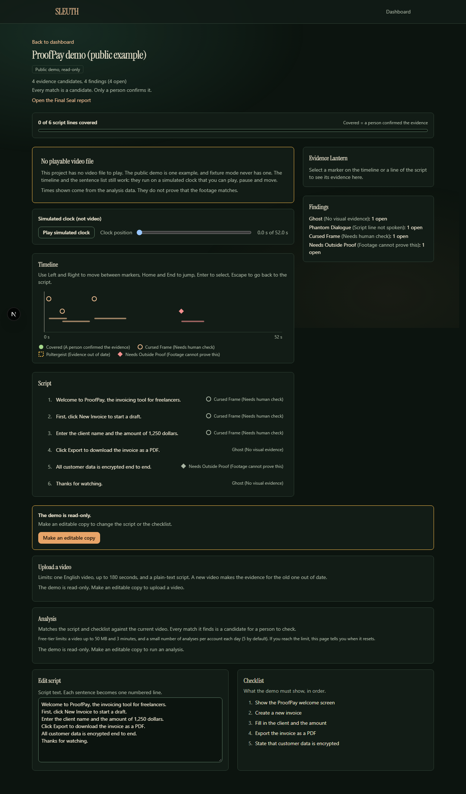

# Blog post

Final text, 14 November 2026. Publish it on a public site the team controls, then put its URL on Devpost. Re-check each number on publishing day (commands are in `docs/submission/devpost.md`).

**Title:** A haunted studio for demo videos: building SLEUTH with Kiro

*We wrote this for the Kiroween 2026 hackathon.*

Demo videos lie by accident. A step gets cut in editing, a screen changes, a script line is reworded after the take. SLEUTH is our Kiroween project: a QA workspace that checks a demo video against its script and checklist, and says what it cannot prove.

**Candidates, not verdicts.** SLEUTH never confirms anything on its own. It proposes evidence, and a person confirms or rejects it. A check in our repository flags any new code, outside the review rules, that marks evidence as confirmed.

**Findings with two names.** Every finding has a haunted name and a plain one: Ghost (no visual evidence), Phantom Dialogue (script line not spoken), Cursed Frame (needs a human check), Poltergeist (evidence out of date), Needs Outside Proof (footage cannot prove this). The plain name is always beside the spooky one.

**Change one line, re-check one line.** Each script sentence keeps a stable id and a hash of its normalised text, so "Click Export." and "click export" are the same line, but "3.5" and "35" are not. Edit one sentence and only its evidence goes stale. Upload a new video and all evidence on the old one goes stale.

**Two stores, one contract.** The app runs with no keys on an in-memory golden fixture, and on Supabase in production. Both stores pass the same contract suite, and a throwaway Supabase stack in CI runs every Postgres, Auth and Storage test.

**Specs found our bugs.** We wrote each feature as a Kiro spec with numbered requirements. Requirements marked for property tests became fast-check properties. One random-history test found three bugs in code we had written the same day. The worst: evidence a person had dismissed could later be confirmed on an outdated line.

**Free means slow, so we say so.** The worker runs on a GitHub Actions schedule every 10 minutes. A visitor's job can wait 10 to 15 minutes, and the page says that instead of faking a progress bar.

**What is not done.** We have not measured accuracy. No real clip is recorded and labelled yet, so we publish no precision or recall number. The repository's `docs/evidence-confidence.md` will show one when the clips exist, with the clip count beside it.

Try it: https://sleuth-eight.vercel.app. Code: https://github.com/dngvmnh/sleuth (MIT).

Built by Đạt (@phatdat220707), Đăng (@dngvmnh) and Phạm Quốc Bảo (@baofrovn).
